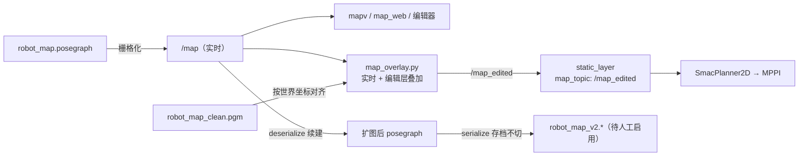

# 卡-09：地图编辑与自主探索（P2-B1/A4/B2）

- **卡号**：09
- **所属阶段**：P2 地图与自主能力
- **依赖卡号**：03（Nav2）、02（EKF）——均已满足
- **可并行**：否
- **状态**：**已实现，待现场验收**（软件链路已通并离线验证；第四节实车项需场地）

---

## 一、需求

| 项 | 内容 |
|------|------|
| **目标** | 让小车能自主探索未知环境并建图（B1）；让人工能在手机上擦除假障碍、画虚拟墙并让规划器绕行（A4）；验证动态行人/移动障碍下的绕行或等待（B2）。 |
| **输入** | `/map`（slam_toolbox 实时）、TF `map→base_link`、`/goal_pose`、笔刷操作（世界坐标）。 |
| **输出** | `/map_edited`（nav2 规划用）、`robot_map_vN.*`（存档）、`/explore/status`（SSE）。 |
| **业务规则** | 探索 = 前沿检测 → 发 nav2 目标 → 到达后再检测 → 无前沿即存档。**续建已有图**（默认）+ **存档不切**（另存新版本、不自动激活）。虚拟墙只进全局规划约束。 |
| **禁止行为** | 不得直发 `/cmd_vel`（探索只发目标）；不得覆盖 `robot_map.*`；不得让虚拟墙进 `collision_monitor`（软约束，车被遥控挤入时雷达照常工作）；nav2 必须差速模型、不发 `vy`。 |
| **边界条件** | 起点在已有图外、图内无前沿、nav2 目标连续失败、编辑层与实时地图原点不同、`localization` 模式调 `deserialize_map`。 |
| **验收标准** | 见 17 号文档 P2 放行条件：探索结束并保存地图；切回定位模式仍可导航；编辑地图不覆盖原图；真实障碍仍由雷达与安全层阻停。 |
| **风险区域** | ① 续建起点越界 → 连通孤岛（定位崩溃）；② 用静态 map_server 会让探索卡死（`allow_unknown: false`）；③ 前沿聚类阈值过严会漏掉窄门；④ 编辑层与实时图原点不同导致墙错位。 |

---

## 二、方案

### 核心架构决策：`/map_edited` 用**实时覆盖层**，不用 `nav2_map_server`

**已核实的陷阱**：nav2 的 `static_layer` 订阅 `/map`，而 `/map` 由 slam_toolbox **从 posegraph 栅格化**发布，**不是 PGM** → 把虚拟墙画进 `robot_map.pgm` 对 nav2 **完全无效**。

原计划用 `nav2_map_server` 加载编辑后的 PGM 发 `/map_edited`。**实测不可行**：它是**静态快照**，而探索模式下 `/map` 持续增长；且 `SmacPlanner2D` 配的是 `allow_unknown: false`（不许穿过未知）→ 规划器看不到新探索区 → **探索直接卡死**。

改为 `03_SLAM/map_overlay.py`：

- 编辑层按**世界坐标**对齐到实时地图（两者 origin/resolution 可不同，已单测）
- 编辑层只改**已知**格子（PGM 里 205=未知 不动）→ 不会把新探索区封死
- 无编辑层时纯透传 → 与原行为一致；**一键回退**：`nav2_params.yaml` 的 `map_topic` 改回 `/map`

### 三块的实现

**A4 地图编辑（软约束虚拟墙）**

| 文件 | 作用 |
|---|---|
| `03_SLAM/map_editor.py` | `MapEditor`：`load_from_topic/load_from_msg`、`apply_stroke(cells, mode, radius)`、`undo/reset`、`export(prefix)`（原子写）、`world_to_cell/cell_to_world`、`active_prefix` |
| `05_robot_ui/routes_edit.py` | `/edit/{status,active,load,info,image.png,stroke,undo,reset,save}` |
| `www/edit.{html,css,js}` | 画布笔刷 + 撤销/清空/另存 |

- 笔刷：`erase` → 写 `FREE(0)`；`wall` → 写 `OCCUPIED(100)`
- 导出复用 `save_map.save_pgm_yaml`，**tmp + fsync + os.replace** 原子写；rename 后修正 yaml 的 `image:` 字段
- `/edit/save` **拒绝覆盖 `robot_map.*`**（`PROTECTED` 元组）

**B1 前沿探索（续建 + 存档不切）**

| 文件 | 作用 |
|---|---|
| `05_robot_ui/explore.py` | `ExploreRunner`：`detect_frontiers()`（4 邻接连通聚类）、`go(mode)/cancel()`、`_send_goal()`（`NavigateToPose`）、`_run()` 主循环、`_save_new_version()` |
| `05_robot_ui/routes_explore.py` | `/explore/{status,info,image.png,go,cancel,save,activate}` |
| `www/explore.{html,css,js}` | 模式单选 + 启停 + 前沿/目标/车叠加 + 存档/启用 |
| `03_SLAM/save_map.py` | **新增** `deserialize_posegraph()`（照抄 `serialize_posegraph` 的服务调用三件套） |

- **续建**：`go('continue')` 先 `_check_start_in_map()`（TF `map→base_link` 在图内）→ `deserialize_map(robot_map.posegraph)` → 在原图上扩图
- **存档不切**：结束时 `serialize_map(robot_map_vN)`（v2 起递增），**永不覆盖、不自动激活**
- **显式启用**：`/explore/activate` 先备份 `robot_map.*` 到 `04_map/bak_activate/`，再拷贝覆盖（前端 `confirm()` 二次确认）
- **不发 `/cmd_vel`**，只发 `NavigateToPose` 目标 → 复用 P1 统一任务入口与安全链
- `ModeMgr` 新增 `EXPLORE` 模式（`TIMEOUT: None`，长期占控同 PATROL），`claim('explore', 'EXPLORE', force=True, force_unless='PATROL')`

**B2 动态避障**

- **不改算法**（nav2 已有局部重规划 + `obstacle_layer`）
- 新增 `03_SLAM/obstacle_check.py`：监听 `/polygon_slowdown`、`/polygon_stop`、`/cmd_vel`、`/goal_pose`、`/odom`，出「急停次数/最长急停时长/最大速度」摘要 + CSV 事件流水

---

## 三、改动文件清单

### 新增

- `01_Project/03_SLAM/map_editor.py` — 地图编辑核心
- `01_Project/03_SLAM/map_overlay.py` — `/map` + 编辑层 → `/map_edited`
- `01_Project/03_SLAM/obstacle_check.py` — 动态避障验收取证
- `01_Project/05_robot_ui/explore.py` — 前沿探索执行器
- `01_Project/05_robot_ui/routes_edit.py` / `routes_explore.py` — 路由层
- `01_Project/05_robot_ui/www/edit.{html,css,js}` / `explore.{html,css,js}` — 两屏

### 修改

- `01_Project/03_SLAM/save_map.py` — 新增 `deserialize_posegraph()`
- `01_Project/05_robot_ui/app.py` — `ROUTES` 15 条新路由、`PUBLIC` 白名单、`register_feature` 两项
- `01_Project/05_robot_ui/node_teleop.py` — 挂 `self.map_editor` / `self.explore`，`state()` 加 `edit`/`explore` 字段
- `01_Project/05_robot_ui/state_store.py` — `TIMEOUT` 加 `'EXPLORE': None`
- `01_Project/05_robot_ui/www/{index,nav,patrol,hub}.html` — `s-nav` 加「探索」「编辑」两个 tab
- `ros2_ws/src/robot_bringup/params/nav2_params.yaml` — `static_layer.map_topic: /map_edited`
- `ros2_ws/src/robot_bringup/launch/nav2.launch.py` — 起 `map_overlay.py`

---

## 四、验收条件

- [ ] 探索结束并保存地图（`robot_map_vN.*` 出现在 `04_map/`）
- [ ] 切回定位模式仍可导航（`activate` 后 `robotnav --nav2` 能规划）
- [ ] 编辑地图不覆盖原图（`/edit/save` 到 `robot_map` 必须被拒，已离线验证）
- [ ] 真实障碍仍由雷达与安全层阻停（`obstacle_check.py` 抓到 STOP 事件）
- [ ] 续建模式下探索前后是同一张 posegraph 的扩展，旧区域不失真

### 测试覆盖

| 类型 | 场景 | 预期 | 通过 |
|------|------|------|------|
| 正常路径 | 前沿检测 7 场景（环形/两块/全空闲/单点噪声/两格噪声/墙后未知/0.4m 窄门） | 聚类数正确、窄门不被漏 | ✅ 离线单测全过 |
| 正常路径 | 编辑笔刷擦除/画墙/撤销/原子导出 | 格数正确、yaml `image:` 修正、无临时文件残留 | ✅ 离线单测全过 |
| 正常路径 | 编辑层与实时图**不同原点**混合 | 虚拟墙落在正确世界坐标、未编辑区不被污染 | ✅ 离线单测全过 |
| 正常路径 | `/map` → `map_overlay` → `/map_edited` 透传 | 尺寸/origin 保留 | ✅ live 集成测试 |
| 异常输入 | `/edit/save` 指向 `robot_map` | **拒绝**（另存不覆盖原则） | ✅ HTTP 实测 |
| 异常输入 | `/explore/go?mode=bogus` | 参数校验拒绝 | ✅ HTTP 实测 |
| 边界值 | 续建时起点在图外 | **拒绝续建**，提示把车开回图内 | ✅ HTTP 实测（slam 未跑时正确报「取不到定位 TF」） |
| 边界值 | 未载入地图就 stroke/undo | 优雅降级提示，不抛异常 | ✅ HTTP 实测 |
| 重复执行 | 五屏导航一致性 | 每屏 6 个 tab、1 个高亮 | ✅ HTTP 实测 |
| 外部失败 | nav2 栈没起时 `explore/go` | 优雅拒绝 | ✅ HTTP 实测 |
| **实车** | 行人横穿/贴脸障碍 | 绕行或减速等待、急停停住 | ☐ **待现场** |

---

## 五、红队提问

| 问题 | 回答 |
|------|------|
| 与需求有何差异？ | 「指定区域探索」实际实现为**整张图直到无前沿**（用户确认）；未做矩形框选。`nav2_map_server` 改为 `map_overlay.py`（理由见 §2）。 |
| 未要求的假设？ | 假设探索期间不需要同时编辑地图（编辑屏不认领 ModeMgr，两者可并存但编辑不影响运行中的探索）。 |
| 异常输入下会怎样？ | 笔刷全在图外、模式非法、续建起点越界、存档指向原图 —— 均**优雅拒绝并返回中文原因**（已实测）。 |
| 哪里会悄无声息地失败？ | ① **编辑层与实时图原点不同**：已按世界坐标对齐并单测；但若 `/map` 原点在探索中**漂移**（slam_toolbox 扩图时可能重设 origin），已存的编辑层会错位 → 需要现场确认扩图时 origin 是否稳定。② **`active_prefix` 会优先选 `robot_map_clean`**：若目录里残留别的 `_clean` 文件会被误判为激活图（实测踩过，已把旧的去噪实验产物归档到 `bak_20261020_denoise_exp/`）。 |
| 哪些只是看起来实现了？ | 「探索完成」只是「无前沿」，不代表地图质量好（可能有重影）→ 所以**存档不切**，必须人工检查后再 `activate`。 |
| 需求变化哪里易改错？ | 若改 `CLUSTER_MIN`（当前 4），过大漏窄门、过小出噪声目标；若改 `map_topic` 回 `/map`，虚拟墙会失效（但探索不受影响）。 |

---

## 六、签核

- [x] 八问 + 硬约束全部通过（**按「已知情接受」签核**：1 项实车覆盖未做）
- [ ] 现场验收（B2 动态避障 + 探索实际扩图）

**签核结论**：2026-10-20 软件链路全部落地并离线验证——前沿检测 7 场景、编辑笔刷/原子导出、编辑层跨原点混合、`/map`→`/map_edited` 透传、保护性拒绝（不得覆盖 `robot_map.*`）、续建前置校验、五屏导航一致性均通过。

**遗留 3 项**（实车验收前需处理）：
1. **B2 动态避障实车验收**（`obstacle_check.py` 已就位，需行人配合）；
2. **探索实际扩图**未跑（需 mapping 模式 + nav2 同时起）；
3. **`/map` origin 在扩图时是否稳定**未验证 —— 若不稳定，已存编辑层会错位。
