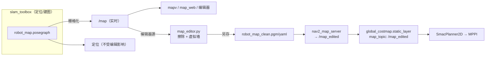

## 用户需求

### 2026-10-20 实现修正与使用边界

- 编辑页已修复：重绘保留缩放/平移；笔刷、撤销、清空与保存按提交顺序执行；清空编辑恢复抓取时的地图像素；撤销恢复整笔；保存/载入按钮完成请求后可再次点击。编辑器对 HTTP 并发操作加锁，载图复用已缓存的地图，不在网页线程嵌套 spin。
- 探索必须运行在 **mapping** 模式：`robot --nav2 --ekf`。`robotnav --nav2 --ekf` 是定位模式，探索启动会明确拒绝。探测源仅为原始 SLAM `/map`，不使用编辑图或磁盘兜底图做前沿搜索。
- “续建已有图”是载入 posegraph 后扩展未知区域；起始位姿须与旧图对齐。续建请求现在明确指定匹配方式与起始位姿，并等更新地图。原“从零探索”按钮改为“探索当前图”，不会隐式删除现有图；真正从零需新启动建图进程。本轮已经续建过旧图时，不允许用该按钮假装清零。
- 观察目标从已知空闲区选取：过滤小未知岛、墙边缝隙；检查障碍间距（当前中心离障碍至少 0.25m）、可达路径、退让距离以及本轮已访问/失败目标。没有安全可达的新前沿时停车结束；连续三个观察点未增加有效已知区域时结束。方向与路线由 Nav2 执行，探索不等同于按条带覆盖已知房间。
- 探索开始前不会强抢其他任务；探索执行中先停止再切换控制。探索页、网页总停止、任务入口和语音停止均取消探索 action 并锁存零速，防止后台再次下目标。
- 探索到达要复核定位新鲜度和位置误差；地图断流、定位过期会停止。仅发现新区域时自动存档，输出配套栅格图与 posegraph，仍不自动启用。
- 当前地图入口使用 `map_overlay`：实时地图与编辑覆盖层输出 `/map_edited`。下文涉及独立 `nav2_map_server` 的段落是初期设计，运行接线以现有 launch 为准。

验证：8 项隔离回归检查通过，覆盖地图像素恢复、封闭房间/墙缝过滤、开放前沿、不可达区域、定位模式拒绝、控制互斥/停止、有效续建请求；浏览器端实际点击测试通过缩放/平移/复位、画笔后撤销/清空、载入/保存按钮复用。当前保存图的旧检测得到 8 个边界簇，安全筛选得到 0 个有效观察点。**这些属于软件验证；续建位姿对齐、真实未知入口与动态避障仍待现场验收，P2 尚未整体放行。**

针对 P2 阶段「地图与自主能力」做完整实施规划，覆盖三件事：B1 前沿探索建图、A4 地图编辑与虚拟墙、B2 动态避障实车验收。三项全部要过放行条件。

## 产品概述

在现有导航栈（MPPI + collision_monitor + 统一控制链）之上补齐两类自主能力：让小车能自己探索未知环境并建图；让人工能在手机上清理假障碍、画虚拟墙并让规划器绕行。全部接入现有四屏手机 UI 与统一任务入口。

## 核心功能

- **B1 自主探索建图**：整张地图探索到无前沿为止，自动保存地图
- **A4 地图编辑**：手机画笔擦除假障碍、画虚拟墙，**另存新版本不覆盖原图**
- **A4 虚拟墙规划约束**：全局规划器绕行；车被遥控挤入时雷达与安全层照常工作
- **B2 动态避障验证**：真实行人/移动障碍下的绕行或等待，安全层阻停
- **手机网页新屏**：探索屏、编辑屏，与现有遥控/航点/巡逻/功能同架构

## 放行条件

- 指定区域探索结束并保存地图
- 切回定位模式仍可导航
- 编辑地图不覆盖原图
- 真实障碍仍由雷达与安全层阻停

## 实施顺序

A4（清假障碍 + 稳定 map 来源）→ B1（探索）→ B2（实车验收）

## 技术栈

- ROS 2 Humble / Python 3.10 / rclpy / nav2（MPPI + RotationShim，DWB 备用）
- `nav2_map_server`（已安装）— 提供编辑版地图
- 前端：纯 HTML + 原生 JS + CSS（沿用 robot_ui 现有无框架架构）
- 图像处理：numpy（PGM 读写复用 `save_map.save_pgm_yaml`）
- 通信：HTTP（`app.py` 表驱动 ROUTES）+ SSE `/events`

## 实现方法

### 核心架构决策：地图来源切换

**已核实的陷阱**：nav2 的 `static_layer` 订阅 `/map`，而 `/map` 由 slam_toolbox **从 posegraph 栅格化**发布，**不是 PGM**。所以把虚拟墙画进 `robot_map.pgm` 对 nav2 完全无效。

解法是**换 map 来源**（`nav2_costmap_filters` 未安装、apt 离线不可用，keepout mask 路线走不通）：



**关键**：编辑器的源必须是 `/map`（slam_toolbox 实时输出），导出时复用 `save_pgm_yaml()` 带上 `origin/resolution`，保证与定位坐标系**逐像素对齐**。不能直接读 `robot_map.pgm`（实测尺寸 748×1011 vs `/map` 327×370，两者不同源）。

### 三块的实现要点

**A4 地图编辑（软约束虚拟墙）**

- 后端 `map_editor.py`：接收笔刷操作（像素坐标 + 半径 + 类型 `erase|wall`），在 `/map` 的 OccupancyGrid 副本上写入 `254(free)`/`0(occupied)`，导出新版本
- 导出命名 `robot_map_clean.pgm/yaml`，**永不写 `robot_map.*`**
- `nav2_map_server` 启动时按「有 clean 版加载 clean、否则加载原始」选择，发 `/map_edited`
- `nav2_params.yaml:473` 的 `static_layer` 块加 `map_topic: /map_edited`
- **软约束**：虚拟墙只进全局规划约束，**不进 `collision_monitor`**（用户确认）
- map_id 跟随「当前激活的地图」，编辑后 map_id 变 → 旧地点自动拒绝（复用 P1 机制）

**B1 前沿探索**

- 无 `explore_lite`，自研 frontier：`/map` 上检测 free 单元格相邻 unknown → 连通域聚类 → 选最近/最大聚类中心
- **不发速度**，只下发目标，走 `/task/request?source=explore&action=goal` → 自动进统一任务入口、自动认领 `ModeMgr`（符合 P1 架构）
- 状态发布为 JSON（`/explore/status`），经 SSE 推到 UI
- 无前沿时自动调用 `save_pgm_yaml` + `serialize_posegraph` 保存地图
- 失败目标换下一个前沿；连续 N 次失败则停止

**B2 动态避障**

- nav2 已有局部重规划 + `obstacle_layer`，属实车验收
- 提供验收脚本（录包 + 复盘）与操作清单，不改算法

## 实现注意事项

- **必须复用统一控制链**：探索不发速度（只发目标）；任何新增运动源不得直发 `/cmd_vel`
- **差速约束**：nav2 必须配差速模型，绝不发 `vy`（麦轮但 odom 差速积分）
- **map 来源对齐**：导出必须带 `/map` 的 origin/resolution；尺寸不符一律拒绝
- **性能**：frontier 检测在 327×370 图上每 1~2 s 一次，Python 足够；笔刷走增量（只传坐标），不传整图
- **CPU 余量**：BT tick 100 超时告警已存在，新增节点要控制频率；探索状态发布 ≤ 2 Hz
- **停止语义**：探索停止必须走 `/stop`（`/cmd?vx=0` 在导航中无效）
- **爆破半径**：map_source 换源影响 nav2 全局规划——保留一键回退（改回 `/map` 即原行为）
- **原子写**：地图导出用 tmp + `os.replace` + `fsync`（仿 `places.py`）

## 架构设计

新增两个 robot_ui 模块（仿 `patrol.py` 的进程内模式）+ 两个前端屏 + 一个 ROS 节点（map_server）+ 一个独立工具（map_editor）。

数据流见上方 mermaid 图。控制流：UI → ROUTES → `node_teleop`/`explore.py` → `/task/request` → nav2 → `/cmd_vel_nav` → mux → collision_monitor → `/cmd_vel`。

## 目录结构

```
RobotCode/
├── 01_Project/
│   ├── 03_SLAM/
│   │   ├── map_editor.py        # [NEW] PGM/地图编辑核心：笔刷应用、版本导出（复用 save_pgm_yaml）
│   │   └── save_map.py          # [MODIFY] 复用 save_pgm_yaml；导出改名逻辑
│   └── 05_robot_ui/
│       ├── map_editor.py        # [NEW] 编辑服务：接收笔刷、生成/清理编辑版
│       ├── explore.py           # [NEW] frontier 检测/聚类/选点 + 目标下发 + 状态发布
│       ├── routes_edit.py       # [NEW] /edit/* 路由
│       ├── routes_explore.py    # [NEW] /explore/* 路由
│       ├── node_teleop.py       # [MODIFY] state() 增加 explore/edit 字段
│       ├── app.py               # [MODIFY] ROUTES 登记 + s-nav 导航
│       └── www/
│           ├── edit.html        # [NEW] 编辑屏：地图画布 + 画笔工具栏
│           ├── edit.js          # [NEW] canvas 笔刷、坐标换算、保存/撤销
│           ├── explore.html     # [NEW] 探索屏：启动/停止 + 前沿可视化 + 进度
│           ├── explore.js       # [NEW] SSE 状态渲染 + 控制按钮
│           └── *.html           # [MODIFY] s-nav 加「探索」「编辑」两个 tab
├── ros2_ws/src/robot_bringup/
│   ├── params/nav2_params.yaml  # [MODIFY] static_layer 加 map_topic: /map_edited
│   └── launch/bringup.launch.py # [MODIFY] 增加 nav2_map_server 节点
└── 02_doc/
    ├── 09_使用说明.md            # [MODIFY] 加探索/编辑用法
    ├── 17_统一功能路线图.md      # [MODIFY] P2 放行条件回填
    └── 04_执行检验/卡-09-地图编辑与探索.md  # [NEW] P2 卡片
```

## 关键代码结构

```python
# map_editor.py — 编辑核心（复用 save_map.save_pgm_yaml）
class MapEditor:
    def load_from_topic(self, node, timeout=10.0) -> OccupancyGrid
    def apply_stroke(self, cells: list[tuple[int,int]], mode: str, radius: int) -> bool
    def export(self, prefix: str) -> list[str]          # 写 <prefix>.pgm/.yaml，原子写
    def active_prefix(self) -> str                       # clean 版优先，否则原始

# explore.py — 状态发布
EXPLORE_STATUS = {
    'running': bool, 'frontiers': int, 'visited': int,
    'goal': {'x': float, 'y': float} | None,
    'failed': int, 'msg': str,
}
```

## 设计风格

延续现有四屏 UI 的深色科技仪表盘风格，新增「探索」屏与「编辑」屏。两屏共用 `common.css`/`sub.css`、底部 `s-nav` 标签栏、SSE 状态推送与 token 鉴权，视觉与遥控屏保持同一套语言，不引入新框架。

**探索屏**：地图为主视觉（占屏 65%），上方浮层显示探索进度（前沿数/已访问/当前目标），底部固定控制区（开始/暂停/停止 + 自动保存开关）。前沿点以青色高亮在地图上实时叠加，当前目标用琥珀色标记，已访问前沿变灰。

**编辑屏**：地图全屏画布（可平移缩放），顶部工具条（画笔类型：擦除假障碍/画虚拟墙；笔刷大小 1/3/5；撤销/清空/保存），底部状态条显示当前编辑版本与 map_id 摘要。笔刷操作用半透明色层叠加预览（擦除=青、墙=红），松手后落盘。

**交互一致性**：所有写操作走 `withK()` 带 token；探索启动/停止走 `ModeMgr` 认领；停止按钮必须调 `/stop`。

## Agent Extensions

### SubAgent

- **code-explorer**
- Purpose: 在动手改代码前，逐个核实 robot_ui 的集成点（`ROUTES` 表、各 `www/*.html` 的 `s-nav` 导航、`ModeMgr` 认领方式、`state()` 字段结构、`save_pgm_yaml` 复用路径），确认没有遗漏的挂接处
- Expected outcome: 输出一份「需要修改的文件与精确行号」清单，确保新增的两个屏和两个模块与现有 patrol/places 的模式完全对齐，避免漏改导航栏或状态字段
