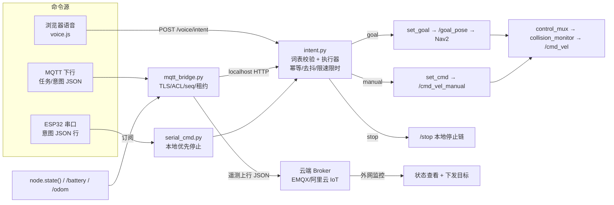

## 用户需求

实现 P3 阶段「语音与远程入口」三件套：MQTT 遥测/任务桥、浏览器语音交互原型、ESP32 串口命令接口与共用意图词表/执行入口。外网监控经 MQTT 上云，不暴露板端 HTTP。ESP32 固件不在本期，但串口协议与意图词表须就绪，硬件确认后即插即用。

## 产品概述

在现有四屏手机 UI 与统一任务入口之上补齐语音与远程两类控制入口：手机浏览器说话即可下达有限意图命令并语音播报结果；云端经 MQTT 查看小车状态、通过同一任务入口下发目标；后续 ESP32 离线语音经串口接入同一意图执行层。所有运动命令共用同一鉴权、同一任务入口、同一安全链。

## 核心功能

- **共用意图词表与执行入口**：有限集合（停止、前进、后退、左转、右转、回原点、去地点、开始/停止巡逻），词表外话语拒绝且不触发动作
- **浏览器语音屏**：说话下意图、识别文本与意图结果反馈、到点/结果语音播报；误识别时「停止」按钮始终兜底
- **MQTT 遥测上行**：状态/电量/位姿/任务结果，消息含设备 ID、时间戳、序列号
- **MQTT 任务下行**：经统一任务入口执行，带请求 ID 幂等，目标经地点表与地图版本校验
- **远程命令租约**：心跳超时仅终止远程租约内命令；本地停止与已获准自主任务不受云端断网影响
- **串口命令接口**：接收 ESP32 意图 JSON 行，本地优先停止，断网可用
- **外网监控**：云端看状态、下发目标，与网页同一鉴权口径

## 放行条件

- 断网时本地「停止」有效
- 在线和离线重复命令不重复执行
- 远程掉线时按所属控制租约停车
- MQTT 重连、鉴权和乱序测试通过
- ESP32 板型、Flash/PSRAM、麦克风及固件集成确认后可接入串口协议

## Tech Stack

- ROS 2 Humble / Python 3.10 / rclpy（沿用现状）
- MQTT 客户端：paho-mqtt（需 pip 安装，TLS + 每设备账号 ACL，云端 Broker）
- 串口：pyserial 3.5（已装），新增接口不占用 `/dev/ttyACM0`（底盘专用）
- 浏览器：纯 HTML + 原生 JS + CSS（沿用 robot_ui 无框架架构）；`webkitSpeechRecognition` + `speechSynthesis`
- 通信：HTTP（`app.py` 表驱动 ROUTES）+ SSE `/events`；意图执行经 localhost 回环复用统一任务入口

## Implementation Approach

三源一口：浏览器语音、MQTT 远程、ESP32 串口全部先归一为**意图对象**，再由进程内意图执行器翻译成 `goal/manual/stop` 走既有 `/task/request` 语义（ModeMgr 认领、request_id 幂等、PlaceStore 地图版本校验），速度仍经 `cmd_vel_manual/cmd_vel_nav → control_mux → collision_monitor`，任何新入口不得直发 `/cmd_vel`。MQTT 桥做成独立节点（仿 `control_mux.py` 单文件脚本风格），遥测订阅既有话题上行，任务下行经 localhost HTTP 调 `/voice/intent`/`/task/request`，这样「同一鉴权与任务入口」在代码层面只有一份实现，而不是并行两套。600 ms 心跳停车利用既有 `PhoneTeleop.CMD_TIMEOUT=0.6` 看门狗天然实现：桥对远程 manual 命令按 ≤10 Hz 续租，断链即停止续租，0.6 s 后自动零速；只作用于持有远程租约的命令，本地语音/自主任务不被云端断网打断。乱序防护：消息带 `seq`，桥内按 `seq` 去旧、`request_id` 幂等双保险；重连后重订阅 + 重发遗嘱/在线状态（红队已指出的坑）。

**关键技术决策**

1. 意图执行器放 `robot_ui` 进程内（与 node 同生命周期）：`PatrolRunner` 同款模式，不自建 executor/spin；MQTT 桥跨进程只走 HTTP，避免双 ROS 图入口。
2. 语音目标只接受**地点名**（PlaceStore 白名单）或坐标，大模型/语音不得凭空造点；map_id 不匹配即拒绝。
3. 浏览器麦克风 secure-context 问题：原型阶段文档化 chrome://flags 白名单 + 页面降级提示；同时给 `app.py` 留可选自签 HTTPS 开关，不强制。
4. 串口协议一行一 JSON（`{"intent":"stop|forward|...","args":{...},"req_id":"..."}`），停止命令最高优先、免鉴权直通停止链，其余走同一意图入口。

## Architecture Design



### Module Division

- **intent.py（意图层）**：词表定义、文本/结构化意图解析、执行器（调 node 层函数）、去抖与幂等、限时手动速度（语音前进/后退 1–2 s 自动归零）
- **routes_voice.py + voice.html/voice.js（浏览器语音）**：识别、转写、意图反馈、TTS 播报、停止按钮兜底
- **mqtt_bridge.py（远程入口）**：TLS 连接、设备认证、遥测上行、任务下行、心跳租约、重连/遗嘱/seq 乱序
- **serial_cmd.py（串口接口）**：读行解析、本地停止直通、协议自测桩（无硬件可测）

## Directory Structure

```
RobotCode/
├── 01_Project/
│   ├── 03_SLAM/
│   │   └── mqtt_bridge.py          # [NEW] MQTT 桥：遥测上行/任务下行/TLS/租约/重连
│   └── 05_robot_ui/
│       ├── intent.py               # [NEW] 意图词表+解析+执行器+去抖幂等
│       ├── routes_voice.py         # [NEW] /voice/intent /voice/status 路由
│       ├── serial_cmd.py           # [NEW] ESP32 串口意图监听（协议文档同文件头）
│       ├── _selftest_intent.py     # [NEW] 意图层自测（仿 _selftest_patrol.py）
│       ├── app.py                  # [MODIFY] ROUTES 登记、state() 增 voice/mqtt 字段
│       ├── node_teleop.py          # [MODIFY] state() 增 voice/mqtt 字段
│       └── www/
│           ├── voice.html          # [NEW] 语音屏
│           ├── voice.js            # [NEW] 识别/TTS/停止兜底
│           └── *.html              # [MODIFY] s-nav 加「语音」tab、hub.js 状态更新
├── start_robot.sh                  # [MODIFY] 增 --mqtt/--serial 启动项
└── 02_doc/
    ├── 09_使用说明.md              # [MODIFY] 语音/MQTT/串口用法
    ├── 17_统一功能路线图.md        # [MODIFY] P3 放行条件回填
    └── 04_执行检验/
        ├── 卡-04-MQTT桥接.md       # [MODIFY] 状态回填
        ├── 卡-05-ESP32语音.md      # [MODIFY] RK3588 侧完成标记
        └── 卡-10-语音与远程入口.md # [NEW] P3 验收卡
```

## Key Code Structures

```python
# intent.py — 三源共用意图入口
VOCAB = ('stop', 'forward', 'back', 'left', 'right',
         'home', 'goto_place', 'patrol_start', 'patrol_stop')   # 有限集合，需人工确认

def parse_intent(text: str, source: str) -> dict | None
    # 文本/结构化 JSON → {'intent': str, 'args': dict, 'req_id': str}
    # 词表外返回 None（拒绝，不触发动作）；去抖窗口内同意图不重复执行

def execute(node, intent: dict, source: str) -> dict
    # stop: 直通本地停止链（免鉴权、最高优先）
    # forward/back/left/right: 限时手动速度（≤0.10 m/s，1–2 s 自动归零）
    # goto_place: 仅 PlaceStore 存在的地点名 → set_goal（map_id 校验）
    # patrol_start/stop: 复用 PatrolRunner
```

```python
# mqtt_bridge.py — 消息契约（JSON，含设备 ID/时间戳/序列号）
# 上行  robot/<device>/telemetry   {dev, ts, seq, pose, vel, battery, mode, goal}
# 上行  robot/<device>/result      {dev, ts, seq, req_id, ok, msg}
# 下行  robot/<device>/task        {dev, ts, seq, req_id, action, args, on_disconnect}
# 在线状态/遗嘱：robot/<device>/presence  online|offline（重连后重发，防红队坑）
```

## Design Style

延续 robot_ui 现有深色科技仪表盘风格，新增「语音」屏为第五个 tab，与遥控/航点/巡逻/功能同架构（common.css/sub.css、s-nav 底栏、SSE 状态、token 鉴权），不引入新框架。

## Page Blocks（voice.html）

- **顶部状态条**：连接状态（识别服务/云端/串口三路指示灯）、当前模式与 holder，SSE 实时刷新
- **麦克风主控区**（占屏约 50%）：大圆形麦克风按钮，按下录音并波形动效，松开提交；识别中呼吸光
- **转写与意图反馈区**：原始识别文本（次级色）+ 命中意图与参数（高亮色）+ 拒绝原因提示（琥珀色）
- **停止兜底区**：全宽红色「停 止」常驻按钮（误识别兜底，最高优先）+ 最近指令历史列表
- **底部 s-nav**：遥控 | 航点 | 巡逻 | 语音 | 功能，「语音」tab 高亮

## Interaction

所有写操作走 withK() 带 token；识别失败/不支持时显示降级提示（iOS Safari、secure-context 未开启）；TTS 播报到点/结果；提交命令后按钮短促反馈。

## Agent Extensions

### SubAgent

- **code-explorer**
- Purpose: 动手前核实 robot_ui 挂接点（ROUTES 表、4 个 www/*.html 的 s-nav、hub.js 功能注册、state() 字段结构、/task/request 参数形态），确认 P2 并行改动的合并面
- Expected outcome: 输出「需修改文件与精确行号」清单，确保语音屏/意图路由与现有 patrol/places 模式完全对齐，避免漏改导航栏或状态字段